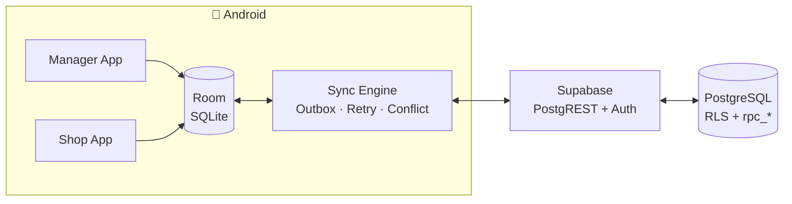

<div align="center">

# 📚 Pakdel Stationery — پاکدل

**سامانه یکپارچه مدیریت فروشگاه لوازم‌التحریر و فروش آنلاین**

*An offline-first retail platform for stationery stores — Android · Kotlin · Supabase*

[**فارسی**](#-پارسی) · [**English**](#-english)

[](https://github.com/Alvandcode/pakdel-stationery/actions/workflows/android.yml)
[](https://github.com/Alvandcode/pakdel-stationery/releases)
[](https://kotlinlang.org)
[](https://developer.android.com/jetpack/compose)
[](https://supabase.com)
[](#-license)

</div>

---

<a id="-پارسی"></a>

# 🇮🇷 پاکدل — نسخهٔ فارسی

> فروشگاهی که وقتی اینترنت قطع می‌شود، از فروش نمی‌افتد.

**پاکدل** یک سامانهٔ فروش و مدیریت کامل برای فروشگاه‌های لوازم‌التحریر است: دو اپلیکیشن اندروید، یک بک‌اند Postgres با منطق تجاری اتمیک، و همگام‌سازی آفلاین‌اول که فروشِ ثبت‌شده را هرگز از دست نمی‌دهد.

| اپلیکیشن | مخاطب | هدف |
|:---|:---|:---|
| **Pakdel Manager** | صاحب فروشگاه، مدیر، فروشنده، صندوقدار، انباردار | داشبورد، محصولات، صندوق فروش، انبار، مشتری و نسیه، کارکنان، گزارش |
| **Pakdel Shop** | مشتری | کاتالوگ، سبد خرید، سفارش آنلاین، باشگاه مشتریان |

## ✨ چرا پاکدل؟

- **آفلاین‌اول واقعی** — فروش، حتی بدون اینترنت ثبت می‌شود؛ در Outbox محلی می‌ماند و با بازگشت شبکه ارسال می‌شود. اپ kill شدن هم چیزی را از بین نمی‌برد.
- **حساب‌وکتاب سرورساید** — تمام محاسبات مالی و کسر موجودی داخل تراکنش‌های PL/pgSQL انجام می‌شود؛ اپ فقط نمایش می‌دهد.
- **بدون فروش تکراری** — هر عملیات نوشتاری `client_operation_id` یکتا دارد؛ ارسال دوباره در سرور بی‌اثر است (idempotent).
- **چند شعبه از روز اول** — مدل داده برای چند فروشگاه/شعبه طراحی شده، نه وصلهٔ بعدی.
- **امنیت با RLS** — هر نقش فقط همان چیزی را می‌بیند و می‌نویسد که مجاز است؛ کلید محرمانه هرگز در اپ نیست.
- **فارسی کامل و راست‌به‌چپ** — تاریخ شمسی، اعداد فارسی، مبالغ تومانی، تقویم و چیدمان RTL.
- **بدون نیاز به Android Studio** — GitHub Actions تست می‌گیرد و APK می‌سازد؛ فقط کد را push کنید.

## 🧩 نمای کلی معماری



منطق تجاری (فروش، مرجوعی، خرید، تعدیل انبار، نسیه، لغو فاکتور) در توابع `rpc_*` دیتابیس است؛ اپ اندروید هیچ‌گاه موجودی یا بدهی را خودش نهایی نمی‌کند.

## 🚀 شروع سریع

**۱. فقط APK را می‌خواهید؟**
به [صفحهٔ Releases](https://github.com/Alvandcode/pakdel-stationery/releases) بروید و `app-manager-debug.apk` و `app-shop-debug.apk` را روی گوشی اندروید ۸+ نصب کنید.

**۲. می‌خواهید بک‌اند خودتان را بالا بیاورید؟**

```bash
# 1) پروژه Supabase بسازید، سپس:
cd supabase
cp .env.example .env.local        # توکن و ref پروژه را بگذارید
node deploy.mjs                   # اجرای مهاجرت‌ها ۰۱ تا ۰۸
# 2) بررسی نصب: فایل verify.sql را در SQL Editor اجرا کنید

# 3) ساخت اپ (نیازمند JDK 17 + Android SDK):
cd ../android && ./gradlew :app-manager:assembleDebug :app-shop:assembleDebug
```

**۳. بدون هیچ ابزاری روی کامپیوتر؟**
دستور کار کامل و گام‌به‌گام: [`docs/06-github-build.md`](docs/06-github-build.md) — GitHub برای شما تست و APK می‌سازد.

## 🧱 پشتهٔ فناوری

| لایه | انتخاب |
|:---|:---|
| زبان / UI | Kotlin 2.0.21 · Jetpack Compose · Material 3 · RTL |
| معماری | MVVM + Clean · Hilt (DI) · Coroutines/Flow |
| داده محلی | Room (شامل Outbox و Ledger) · DataStore · WorkManager |
| بک‌اند | Supabase: PostgreSQL · Auth · PostgREST · RLS |
| منطق تجاری | PL/pgSQL با توابع `rpc_*` اتمیک و idempotent |
| بیلد/CI | Gradle 8.9 · AGP 8.7.3 · GitHub Actions (JDK 17) |
| پول | `bigint` تومان — بدون اعشار، بدون خطای شناوری |

## 📦 ساختار مخزن

```
pakdel-stationery/
├── android/
│   ├── app-manager/        # اپ مدیر و صندوق فروش
│   ├── app-shop/           # اپ مشتری
│   └── core/
│       ├── common/         # پول، تاریخ شمسی، Result، Dispatcher
│       ├── designsystem/   # تم، تایپوگرافی، کامپوننت‌های RTL
│       └── data/           # Room، Supabase، Repository، SyncEngine
├── supabase/
│   ├── migrations/         # ۸ مهاجرت: ساختار، ایندکس، توابع، RPC، RLS، Seed
│   ├── deploy.mjs          # اجرای مهاجرت‌ها با Management API
│   └── verify.sql          # بررسی سلامت نصب (۳۹ جدول، ۲۵ تابع، RLS)
├── docs/                   # معماری، دیتابیس، API، نقشه راه، راه‌اندازی، بیلد
└── .github/workflows/      # تست + ساخت APK + انتشار خودکار
```

## ✅ وضعیت پروژه

| بخش | وضعیت |
|:---|:---:|
| دیتابیس کامل: جدول‌ها، ایندکس‌ها، RLS، توابع اتمیک | ✅ |
| ورود، داشبورد، محصولات، انبار، صندوق فروش، مشتری/نسیه، تنظیمات | ✅ |
| کارکنان: نقش‌ها، فعال/غیرفعال، افزودن عضو | ✅ |
| همگام‌سازی دوطرفه + رفع تعارض + تلاش مجدد | ✅ |
| کاتالوگ مشتری + فیلتر دسته‌بندی | ✅ |
| سبد خرید، سفارش آنلاین، پرداخت (Shop) | ⏳ |
| خرید، تأمین‌کننده، حسابداری، گزارش‌های مالی | ⏳ |
| اسکن بارکد، چاپ ESC/POS، فاکتور PDF | ⏳ |
| تست‌های واحد و یکپارچه | 🟡 در حال گسترش |

نقشهٔ کامل: [`docs/04-roadmap.md`](docs/04-roadmap.md)

## 🔐 اصول غیرقابل مذاکره

- مبالغ: `Long` تومان؛ تبدیل ریال فقط در لایه نمایش.
- محاسبات مالی/موجودی فقط در سرور، داخل تراکنش.
- هر نوشتن با `client_operation_id` یکتا → بدون تکرار.
- حذف نرم؛ گردش انبار برگشت‌ناپذیر (اصلاح با ثبت معکوس، نه ویرایش).
- فقط `anon key` در اپ؛ `service_role` هرگز.
- فروش ثبت‌شده حتی وقتی سرور رد کند حذف نمی‌شود؛ `rejected` می‌ماند برای حسابرسی.
- کاتالوگ مشتری عمومی است، ولی اپ مدیر همیشه به `store_id` خودش محدود می‌شود.

## 👥 نقش‌ها

| نقش | دسترسی |
|:---|:---|
| `owner` | همه‌چیز، تنظیمات، مدیریت کارکنان |
| `manager` | عملیات روزمره، گزارش، بدون تغییر مالکیت |
| `sales` | فروش، مشتری، مشاهده محصولات |
| `cashier` | فقط فروش و مشتری |
| `warehouse` | محصولات و انبار |

## 📚 مستندات

| سند | موضوع |
|:---|:---|
| [`docs/01-architecture.md`](docs/01-architecture.md) | تصمیم‌های معماری (ADR)، لایه‌بندی، جریان آفلاین |
| [`docs/02-database.md`](docs/02-database.md) | مدل داده، جدول‌ها، سیاست‌های RLS |
| [`docs/03-api.md`](docs/03-api.md) | قرارداد RPC، ورودی/خروجی، کدهای خطا |
| [`docs/04-roadmap.md`](docs/04-roadmap.md) | نقشه راه مرحله‌به‌مرحله |
| [`docs/05-setup.md`](docs/05-setup.md) | راه‌اندازی محیط توسعه |
| [`docs/06-github-build.md`](docs/06-github-build.md) | ساخت APK در GitHub بدون اندروید استودیو |

<a id="-license"></a>

## 📄 مجوز

کد این مخزن اختصاصی است (Proprietary). استفادهٔ تجاری، بازنشر یا مشتق‌سازی بدون اجازهٔ کتبی مالک مجاز نیست.

<div align="right">ساخته‌شده برای فروشگاه لوازم‌التحریر پاکدل · ۱۴۰۴</div>

---

<a id="-english"></a>

# 🇬🇧 Pakdel Stationery — English

> A stationery store that never stops selling when the internet does.

**Pakdel** is a complete retail platform for stationery shops: two Android apps, a PostgreSQL backend with atomic business logic, and an offline-first sync layer that never loses a recorded sale.

| App | Audience | Purpose |
|:---|:---|:---|
| **Pakdel Manager** | Owner, manager, sales, cashier, warehouse | Dashboard, products, POS, inventory, customers & credit, staff, reports |
| **Pakdel Shop** | Customer | Catalog, cart, online orders, loyalty |

## ✨ Highlights

- **Truly offline-first** — sales are committed locally, queued in an Outbox, and replayed when connectivity returns; even a process kill loses nothing.
- **Server-side accounting** — every financial and stock movement runs inside an atomic PL/pgSQL transaction. The client only renders.
- **No duplicate sales** — every write carries a unique `client_operation_id`, making all RPCs idempotent.
- **Multi-store / multi-branch by design**, not as an afterthought.
- **Security by RLS** — each role sees exactly what it may see; no secret key ships in the app.
- **Full Persian UX** — Jalali calendar, Persian digits, Toman amounts, true RTL layout.
- **No Android Studio required** — GitHub Actions runs tests and builds the APKs on push.

## 🧩 Architecture at a glance


Business rules (checkout, returns, purchases, stock adjustments, credit, cancellations) live in `rpc_*` database functions. The Android client never finalizes stock or balances on its own.

## 🚀 Quick start

**Just want the APKs?** Grab `app-manager-debug.apk` and `app-shop-debug.apk` from [Releases](https://github.com/Alvandcode/pakdel-stationery/releases) — Android 8.0+.

**Set up your own backend:**

```bash
cd supabase
cp .env.example .env.local        # add your access token + project ref
node deploy.mjs                   # applies migrations 01 → 08
# then run verify.sql in the SQL editor to confirm 39 tables / 25 functions / RLS

cd ../android
./gradlew :app-manager:assembleDebug :app-shop:assembleDebug   # JDK 17 + Android SDK
```

**No local toolchain?** Follow [`docs/06-github-build.md`](docs/06-github-build.md) — GitHub builds and signs the APK for you.

## 🧱 Tech stack

| Layer | Choice |
|:---|:---|
| Language / UI | Kotlin 2.0.21 · Jetpack Compose · Material 3 · RTL |
| Architecture | MVVM + Clean · Hilt · Coroutines & Flow |
| Local data | Room (Outbox + Ledger) · DataStore · WorkManager |
| Backend | Supabase: PostgreSQL · Auth · PostgREST · RLS |
| Business logic | Atomic, idempotent PL/pgSQL `rpc_*` functions |
| Build / CI | Gradle 8.9 · AGP 8.7.3 · GitHub Actions (JDK 17) |
| Money | `bigint` Toman — no decimals, no floating-point drift |

## ✅ Project status

| Area | State |
|:---|:---:|
| Full database: tables, indexes, RLS, atomic functions | ✅ |
| Auth, dashboard, products, inventory, POS, customers & credit, settings | ✅ |
| Staff: roles, activate/deactivate, invite | ✅ |
| Bidirectional sync + conflict resolution + retry | ✅ |
| Customer catalog + category filter | ✅ |
| Cart, online orders, payments (Shop) | ⏳ |
| Purchases, suppliers, accounting, financial reports | ⏳ |
| Barcode scanning, ESC/POS printing, PDF invoices | ⏳ |
| Unit & integration tests | 🟡 growing |

Full plan: [`docs/04-roadmap.md`](docs/04-roadmap.md)

## 🔐 Non-negotiable rules

- Money is `Long` Toman; Rial conversion happens only in the presentation layer.
- All financial and stock math runs server-side inside a transaction.
- Every write carries a unique `client_operation_id` → duplicates are impossible.
- Soft deletes only; the inventory ledger is immutable (corrections are reversing entries).
- Only the `anon` key ships in the app; `service_role` never does.
- A recorded sale is never deleted — if the server rejects it, it stays as `rejected` for audit.
- The customer catalog is public, but the manager app is always scoped to its own `store_id`.

## 👥 Roles

| Role | Scope |
|:---|:---|
| `owner` | Everything, settings, staff management |
| `manager` | Daily operations and reports, no ownership changes |
| `sales` | Sales, customers, product browsing |
| `cashier` | Sales and customers only |
| `warehouse` | Products and inventory |

## 📚 Documentation

Architecture (ADRs), data model & RLS, RPC contract, roadmap, setup, and the Android-Studio-free build guide live in [`docs/`](docs/). Start with [`docs/01-architecture.md`](docs/01-architecture.md).

## 📄 License

Proprietary. Commercial use, redistribution, or derivative works require written permission from the owner.

<div align="right">Built for Pakdel Stationery · 1404 / 2026</div>
